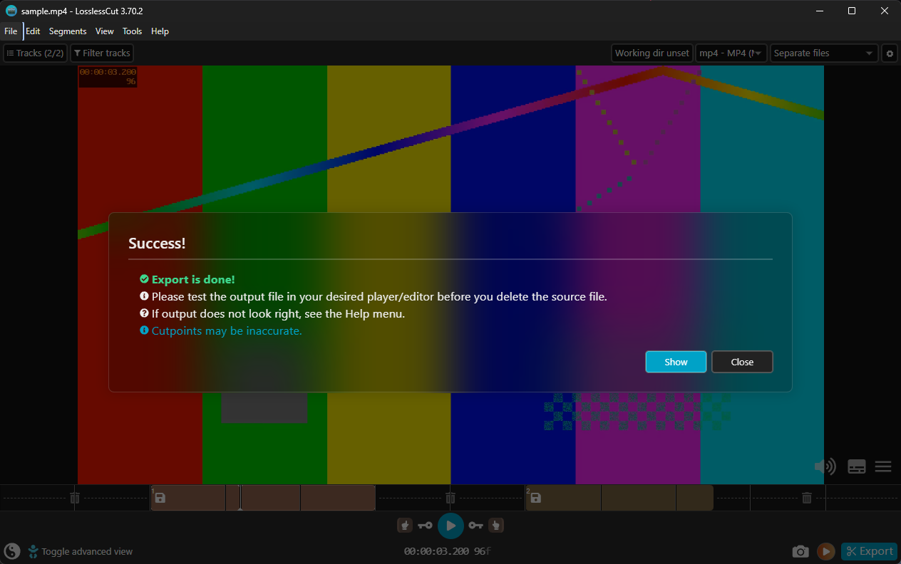

<div align="center">

# losslesscut-mcp

**Let Claude and other AI assistants drive [LosslessCut](https://github.com/mifi/lossless-cut).**

An [MCP](https://modelcontextprotocol.io) server that talks to LosslessCut's local HTTP API, so you can say
*"cut 0:02–0:05 and 0:07–0:09.5 out of this video and export them"* and get the files.

English · [Türkçe](README.tr.md)

</div>



*Two segments added and exported by Claude through losslesscut-mcp, in LosslessCut 3.70.2.*

## What it can do

| Tool | What it does |
| --- | --- |
| `check_connection` | Checks that LosslessCut is running with its HTTP API on `127.0.0.1` |
| `open_files` | Opens media or `.llc` project files (absolute paths only, checked to exist) |
| `seek` | Moves the playhead to a time (`75.5`, `01:15.5`, `00:01:15.500`) |
| `add_segment` | Adds a segment from `start` to `end` |
| `set_cut_points` | Sets the start and/or end of the current segment |
| `select_segments` | Selects all / none / invert / only current / toggle current / at playhead |
| `jump_to_segment` | Goes to the first, last, next or previous segment |
| `export_file` | Exports the selected segments, confirms the export dialog, returns the output paths |
| `wait_for_export` | Waits for a running export and returns its output paths |
| `close_file` | Closes the current file |
| `list_actions` | Lists the 135 keyboard actions that `run_action` accepts, by category |
| `run_action` | Runs one allowed keyboard action, such as `splitCurrentSegment` or `toggleStripAudio` |

Lossless cutting itself is done by LosslessCut and FFmpeg, exactly as if you clicked the buttons. This server only presses them.

## Requirements

- [LosslessCut](https://github.com/mifi/lossless-cut/releases) 3.70 or newer (tested with 3.70.2 on Windows 11)
- [Node.js](https://nodejs.org) 20 or newer
- An MCP client: Claude Desktop, Claude Code, or any other client that supports stdio servers

## 1. Start LosslessCut with the HTTP API

The API is off by default. Start LosslessCut from a terminal with `--http-api`:

```bash
# Windows
"C:\path\to\LosslessCut.exe" --http-api

# macOS
/Applications/LosslessCut.app/Contents/MacOS/LosslessCut --http-api

# Linux
./LosslessCut --http-api
```

It listens on `127.0.0.1:8080`. To use another port, pass it: `--http-api 8081`, and set `LOSSLESSCUT_PORT=8081` for this server too.
See LosslessCut's [HTTP API docs](https://github.com/mifi/lossless-cut/blob/master/docs/api.md).

## 2. Add the server to your client

### Claude Code

```bash
claude mcp add losslesscut -- npx -y github:bariswha/losslesscut-mcp
```

With a custom port:

```bash
claude mcp add losslesscut -e LOSSLESSCUT_PORT=8081 -- npx -y github:bariswha/losslesscut-mcp
```

### Claude Desktop

Open **Settings → Developer → Edit Config** and add this to `claude_desktop_config.json`, then restart Claude Desktop:

```json
{
  "mcpServers": {
    "losslesscut": {
      "command": "npx",
      "args": ["-y", "github:bariswha/losslesscut-mcp"],
      "env": { "LOSSLESSCUT_PORT": "8080" }
    }
  }
}
```

### Other MCP clients

Any client that can start a stdio server works. Use the command `npx -y github:bariswha/losslesscut-mcp`,
or run it from a clone:

```bash
git clone https://github.com/bariswha/losslesscut-mcp.git
cd losslesscut-mcp
npm ci
node src/index.js --port 8080
```

## 3. Ask

- "Open `D:\Videos\talk.mp4` in LosslessCut."
- "Cut out 0:02–0:05 and 0:07–0:09.5, select both segments and export them. Tell me the output files."
- "Jump to the next segment and split it at 1:30."
- "Turn off the audio track and export."

Give the assistant full file paths. It is told never to guess them, and `open_files` rejects relative paths and files that don't exist.

## Configuration

| Setting | Default | |
| --- | --- | --- |
| `--port <n>` or `LOSSLESSCUT_PORT` | `8080` | Port of LosslessCut's HTTP API |

The host is always `127.0.0.1`. It can't be changed.

## Security

- Talks only to `127.0.0.1`. No other network access, no telemetry.
- Never sends an `Origin` header, so LosslessCut's browser protection stays meaningful for everything else.
- `run_action` only runs actions from a fixed allowlist. `quit`, `cleanupFilesDialog` (which can move source files to the trash), `openSendReportDialog` and the URL download action are blocked. Actions that take arguments have their own validated tools.
- All inputs are validated: times are parsed and range-checked, paths must be absolute, existing files without control characters.
- LosslessCut's HTTP API has no authentication: while it runs with `--http-api`, any program on your computer can control it. Only enable it while you use it.

See [SECURITY.md](SECURITY.md).

## Limitations

These come from LosslessCut's experimental HTTP API, which this server only wraps:

- **No read access.** The API can't report the open file, the segments or the playhead, so the assistant has to keep track of what it did.
- **No error feedback.** An action that fails inside LosslessCut still returns success over HTTP. Check the app if something looks off.
- **Timecode format.** `seek` sends `hh:mm:ss.fff`, which LosslessCut parses with its default *timecode with decimal fraction* format. If you switched the timecode format to frames or seconds in its settings, seeking will be wrong.
- **Dialogs.** Actions in the `dialog` group of `list_actions` open a dialog that you complete in the app.

## Development

```bash
npm ci
npm test
```

Tests run against a fake LosslessCut HTTP server and check the request sequence, headers and input validation.

## Not affiliated

losslesscut-mcp is an independent project. It is not affiliated with, endorsed by or maintained by LosslessCut or its author.
LosslessCut is © Mikael Finstad and licensed under GPL-2.0.

## License

[MIT](LICENSE). This server is a separate program that talks to LosslessCut over HTTP and contains no LosslessCut code, so LosslessCut's GPL-2.0 doesn't extend to it, and using it doesn't change how you may use LosslessCut.
