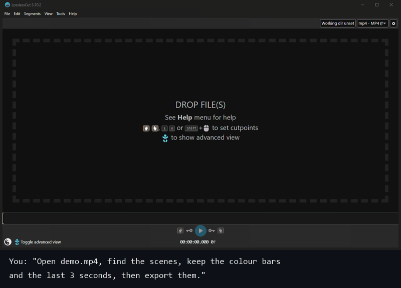

<div align="center">

# losslesscut-mcp

**Let Claude and other AI assistants see your videos and cut them with [LosslessCut](https://github.com/mifi/lossless-cut).**

An [MCP](https://modelcontextprotocol.io) server that looks at your media with FFmpeg (frames, scenes, silence, loudness, keyframes)
and drives LosslessCut through its local HTTP API. Ask *"keep the colour bars and the last 3 seconds and export them"* and get the files, cut losslessly.

English · [Türkçe](README.tr.md)

</div>



*Real run against LosslessCut 3.70.2: every step is an MCP tool call, the screenshots are the LosslessCut window.*

## What it can do

### See and analyse the media

These run locally with FFmpeg and work on any file, with or without LosslessCut open. They mirror what LosslessCut itself can show or detect.

| Tool | What it does |
| --- | --- |
| `media_info` | Duration, container, streams (codec, resolution, fps, audio channels, language) and chapters |
| `contact_sheet` | One image with a grid of frames, to scan a whole video or a part of it |
| `view_frames` | Frames at exact times, or evenly spaced, as images the assistant can look at |
| `detect_scenes` | Scene changes and hard cuts |
| `detect_silence` | Silent parts, and the parts with sound between them |
| `detect_black` | Black parts, such as fades and breaks |
| `audio_levels` | Loudness over time (EBU R128) and the loudest moments |
| `keyframes` | Keyframes, and the ones around given times, to see where a lossless cut will land |
| `check_tools` | Shows which FFmpeg and FFprobe it uses |

### Control LosslessCut

| Tool | What it does |
| --- | --- |
| `check_connection` | Checks that LosslessCut is running with its HTTP API on `127.0.0.1` |
| `open_files` | Opens media or `.llc` project files (absolute paths only, checked to exist) |
| `set_segments` | Loads an exact list of segments (with names) in one step, through LosslessCut's own project file |
| `add_segment` / `set_cut_points` | Adds a segment, or moves the start/end of the current one |
| `seek` | Moves the playhead (`75.5`, `01:15.5`, `00:01:15.500`) |
| `select_segments` / `jump_to_segment` | Selection and navigation |
| `export_file` | Exports the selected segments, confirms the export dialog, returns the output paths |
| `wait_for_export` | Waits for a running export and returns its output paths |
| `close_file` | Closes the current file |
| `list_actions` / `run_action` | 135 allowlisted LosslessCut keyboard actions, such as `splitCurrentSegment` or `toggleStripAudio` |

The cutting itself is done by LosslessCut and FFmpeg without re-encoding, exactly as if you clicked the buttons.

## Requirements

- [LosslessCut](https://github.com/mifi/lossless-cut/releases) 3.70 or newer (tested with 3.70.2 on Windows 11)
- [Node.js](https://nodejs.org) 20 or newer
- FFmpeg and FFprobe on your `PATH` for the analysis tools (or set `LOSSLESSCUT_MCP_FFMPEG` / `LOSSLESSCUT_MCP_FFPROBE`; LosslessCut ships both in its `resources` folder)
- An MCP client: Claude Desktop, Claude Code, or any other client that supports stdio servers

## 1. Start LosslessCut with the HTTP API

The API is off by default. Start LosslessCut from a terminal with `--http-api`:

```bash
# Windows
"C:\path\to\LosslessCut.exe" --http-api

# macOS
/Applications/LosslessCut.app/Contents/MacOS/LosslessCut --http-api

# Linux
./LosslessCut --http-api
```

It listens on `127.0.0.1:8080`. To use another port, pass it: `--http-api 8081`, and set `LOSSLESSCUT_PORT=8081` for this server too.
See LosslessCut's [HTTP API docs](https://github.com/mifi/lossless-cut/blob/master/docs/api.md).

## 2. Add the server to your client

### Claude Code

```bash
claude mcp add losslesscut -- npx -y github:bariswha/losslesscut-mcp
```

### Claude Desktop

Open **Settings → Developer → Edit Config** and add this to `claude_desktop_config.json`, then restart Claude Desktop:

```json
{
  "mcpServers": {
    "losslesscut": {
      "command": "npx",
      "args": ["-y", "github:bariswha/losslesscut-mcp"],
      "env": { "LOSSLESSCUT_PORT": "8080" }
    }
  }
}
```

### Other MCP clients

Any client that can start a stdio server works. Use the command `npx -y github:bariswha/losslesscut-mcp`, or run it from a clone:

```bash
git clone https://github.com/bariswha/losslesscut-mcp.git
cd losslesscut-mcp
npm ci
node src/index.js --port 8080
```

## 3. Ask

- "Open `D:\Videos\talk.mp4` in LosslessCut."
- "Look through this video and tell me where the scenes change."
- "Cut out the silent pauses longer than a second and export the rest as one file."
- "Find the loudest moments, make a 20 second segment around each and export them."
- "Keep 0:02–0:05 and 0:07–0:09.5, name them intro and demo, and export."

Give the assistant full file paths. It is told never to guess them, and every tool rejects relative paths and files that don't exist.

## Configuration

| Setting | Default | |
| --- | --- | --- |
| `--port <n>` or `LOSSLESSCUT_PORT` | `8080` | Port of LosslessCut's HTTP API |
| `--no-frames` or `LOSSLESSCUT_MCP_FRAMES=off` | on | Turns off `view_frames` and `contact_sheet`, so the assistant never receives images of your videos |
| `--disable-tools a,b` or `LOSSLESSCUT_MCP_DISABLE_TOOLS` | none | Turns off any tools by name |
| `LOSSLESSCUT_MCP_FFMPEG` / `LOSSLESSCUT_MCP_FFPROBE` | `ffmpeg` / `ffprobe` | Paths to the FFmpeg binaries |

For example, without frames in Claude Code:

```bash
claude mcp add losslesscut -e LOSSLESSCUT_MCP_FRAMES=off -- npx -y github:bariswha/losslesscut-mcp
```

Most clients can also switch single tools on and off in their own settings: for example the tools menu in Claude Desktop, or `/mcp` and permission rules in Claude Code.

## Security

- Talks only to LosslessCut on `127.0.0.1`. No other network access, no telemetry. Analysis runs locally with FFmpeg.
- Never sends an `Origin` header, so LosslessCut's browser protection stays meaningful for everything else.
- FFmpeg and FFprobe are started directly with an argument list, never through a shell.
- `run_action` only runs actions from a fixed allowlist. `quit`, `cleanupFilesDialog` (which can move source files to the trash), `openSendReportDialog` and the URL download action are blocked.
- All inputs are validated: times are parsed and range-checked, paths must be absolute, existing files without control characters.
- `set_segments` writes LosslessCut's project file next to the media (`<name>-proj.llc`) and renames an existing one to a `.bak` backup first. Nothing else is written, except the exports you ask for.
- LosslessCut's HTTP API has no authentication: while it runs with `--http-api`, any program on your computer can control it. Only enable it while you use it.

See [SECURITY.md](SECURITY.md).

## Limitations

These come from LosslessCut's experimental HTTP API:

- **No read access.** The API can't report the open file, the segments or the playhead, so the assistant keeps track of what it did. The analysis tools read the file itself, not the app.
- **No error feedback.** An action that fails inside LosslessCut still returns success over HTTP.
- **Dialogs.** If LosslessCut opens a dialog (for example when a file is already open), the action waits for you; the server reports that after 30 seconds. Actions in the `dialog` group of `list_actions` always open one.
- **Timecode format.** `seek` sends `hh:mm:ss.fff`, which LosslessCut parses with its default timecode format. If you switched it to frames or seconds, use `set_segments` instead.
- **Lossless cuts snap to keyframes** unless smart cut is on in LosslessCut, so exports can start a little earlier than asked. `keyframes` shows where.

## Development

```bash
npm ci
npm test
```

Tests run against a fake LosslessCut HTTP server, and the analysis tests run real FFmpeg on a generated video when FFmpeg is installed.

## Not affiliated

losslesscut-mcp is an independent project. It is not affiliated with, endorsed by or maintained by LosslessCut or its author.
LosslessCut is © Mikael Finstad and licensed under GPL-2.0.

## License

[MIT](LICENSE). This server is a separate program that talks to LosslessCut over HTTP and runs FFmpeg as a separate process. It contains no LosslessCut or FFmpeg code, so their licences don't extend to it, and using it doesn't change how you may use them.
