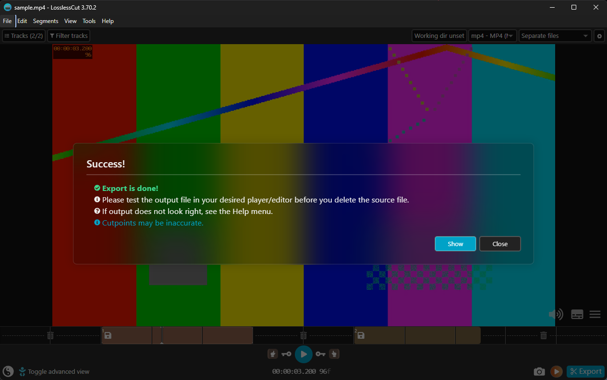

<div align="center">

# losslesscut-mcp

**Claude ve diğer yapay zekâ asistanları [LosslessCut](https://github.com/mifi/lossless-cut)'u kullanabilsin.**

LosslessCut'un yerel HTTP API'siyle konuşan bir [MCP](https://modelcontextprotocol.io) sunucusu.
*"Bu videodan 0:02–0:05 ve 0:07–0:09.5 arasını kes ve dışa aktar"* dersin, dosyalar hazır olur.

[English](README.md) · Türkçe

</div>



*Claude'un losslesscut-mcp üzerinden eklediği ve dışa aktardığı iki segment, LosslessCut 3.70.2.*

## Neler yapabiliyor

| Araç | Ne yapar |
| --- | --- |
| `check_connection` | LosslessCut'un HTTP API ile `127.0.0.1` üzerinde çalıştığını kontrol eder |
| `open_files` | Medya ya da `.llc` proje dosyalarını açar (yalnızca tam yol, varlığı kontrol edilir) |
| `seek` | Oynatma başlığını bir zamana taşır (`75.5`, `01:15.5`, `00:01:15.500`) |
| `add_segment` | `start` ile `end` arasına segment ekler |
| `set_cut_points` | Geçerli segmentin başlangıcını ve/veya bitişini ayarlar |
| `select_segments` | Tümünü / hiçbirini / tersini / yalnızca geçerliyi / geçerliyi değiştir / başlıktakini seçer |
| `jump_to_segment` | İlk, son, sonraki ya da önceki segmente gider |
| `export_file` | Seçili segmentleri dışa aktarır, dışa aktarma penceresini onaylar, çıktı yollarını döndürür |
| `wait_for_export` | Süren dışa aktarmayı bekler ve çıktı yollarını döndürür |
| `close_file` | Geçerli dosyayı kapatır |
| `list_actions` | `run_action`'ın kabul ettiği 135 klavye eylemini kategoriye göre listeler |
| `run_action` | İzin verilen bir klavye eylemini çalıştırır, örneğin `splitCurrentSegment` ya da `toggleStripAudio` |

Kayıpsız kesimi LosslessCut ve FFmpeg yapar, tıpkı düğmelere sen basmışsın gibi. Bu sunucu yalnızca düğmelere basar.

## Gereksinimler

- [LosslessCut](https://github.com/mifi/lossless-cut/releases) 3.70 ya da üstü (Windows 11'de 3.70.2 ile test edildi)
- [Node.js](https://nodejs.org) 20 ya da üstü
- Bir MCP istemcisi: Claude Desktop, Claude Code ya da stdio sunucularını destekleyen başka bir istemci

## 1. LosslessCut'u HTTP API ile başlat

API varsayılan olarak kapalıdır. LosslessCut'u terminalden `--http-api` ile başlat:

```bash
# Windows
"C:\path\to\LosslessCut.exe" --http-api

# macOS
/Applications/LosslessCut.app/Contents/MacOS/LosslessCut --http-api

# Linux
./LosslessCut --http-api
```

`127.0.0.1:8080` adresini dinler. Başka bir port için `--http-api 8081` ver ve bu sunucu için de `LOSSLESSCUT_PORT=8081` ayarla.
LosslessCut'un [HTTP API belgelerine](https://github.com/mifi/lossless-cut/blob/master/docs/api.md) bakabilirsin.

## 2. Sunucuyu istemcine ekle

### Claude Code

```bash
claude mcp add losslesscut -- npx -y github:bariswha/losslesscut-mcp
```

Farklı bir portla:

```bash
claude mcp add losslesscut -e LOSSLESSCUT_PORT=8081 -- npx -y github:bariswha/losslesscut-mcp
```

### Claude Desktop

**Settings → Developer → Edit Config** ile `claude_desktop_config.json` dosyasını aç, şunu ekle ve Claude Desktop'ı yeniden başlat:

```json
{
  "mcpServers": {
    "losslesscut": {
      "command": "npx",
      "args": ["-y", "github:bariswha/losslesscut-mcp"],
      "env": { "LOSSLESSCUT_PORT": "8080" }
    }
  }
}
```

### Diğer MCP istemcileri

stdio sunucusu başlatabilen her istemci çalışır. Komut olarak `npx -y github:bariswha/losslesscut-mcp` kullan
ya da bir klondan çalıştır:

```bash
git clone https://github.com/bariswha/losslesscut-mcp.git
cd losslesscut-mcp
npm ci
node src/index.js --port 8080
```

## 3. İste

- "`D:\Videolar\sunum.mp4` dosyasını LosslessCut'ta aç."
- "0:02–0:05 ve 0:07–0:09.5 arasını kes, iki segmenti de seç ve dışa aktar. Çıktı dosyalarını söyle."
- "Sonraki segmente geç ve 1:30'da böl."
- "Ses parçasını kapat ve dışa aktar."

Asistana tam dosya yolunu ver. Yol tahmin etmemesi söylenir; `open_files` göreli yolları ve var olmayan dosyaları reddeder.

## Yapılandırma

| Ayar | Varsayılan | |
| --- | --- | --- |
| `--port <n>` ya da `LOSSLESSCUT_PORT` | `8080` | LosslessCut HTTP API portu |

Adres her zaman `127.0.0.1`'dir, değiştirilemez.

## Güvenlik

- Yalnızca `127.0.0.1` ile konuşur. Başka ağ erişimi ve telemetri yok.
- Hiçbir zaman `Origin` başlığı göndermez; LosslessCut'un tarayıcı koruması diğer her şey için geçerli kalır.
- `run_action` yalnızca sabit bir izin listesindeki eylemleri çalıştırır. `quit`, `cleanupFilesDialog` (kaynak dosyaları çöpe taşıyabilir), `openSendReportDialog` ve URL indirme eylemi engellidir. Argüman alan eylemlerin doğrulamalı kendi araçları vardır.
- Tüm girdiler doğrulanır: zamanlar ayrıştırılıp aralık kontrolünden geçer, yollar tam yol olmalı, var olan dosyayı göstermeli ve kontrol karakteri içermemelidir.
- LosslessCut'un HTTP API'sinde kimlik doğrulama yoktur: `--http-api` ile çalışırken bilgisayarındaki her program onu kontrol edebilir. Yalnızca kullanırken aç.

Ayrıntılar [SECURITY.md](SECURITY.md) dosyasında.

## Sınırlamalar

Bunlar, bu sunucunun yalnızca sarmaladığı deneysel LosslessCut HTTP API'sinden gelir:

- **Okuma erişimi yok.** API açık dosyayı, segmentleri ya da oynatma başlığını bildiremez; asistan ne yaptığını kendisi takip eder.
- **Hata bildirimi yok.** LosslessCut içinde başarısız olan bir eylem HTTP'de yine başarılı döner. Bir şey ters görünürse uygulamaya bak.
- **Zaman kodu biçimi.** `seek`, `hh:mm:ss.fff` gönderir; LosslessCut bunu varsayılan *ondalık kesirli zaman kodu* biçimiyle okur. Ayarlardan biçimi kare ya da saniyeye çevirdiysen konumlama yanlış olur.
- **Pencereler.** `list_actions` içindeki `dialog` grubundaki eylemler, uygulamada senin tamamlaman gereken bir pencere açar.

## Geliştirme

```bash
npm ci
npm test
```

Testler sahte bir LosslessCut HTTP sunucusuna karşı çalışır; istek sırasını, başlıkları ve girdi doğrulamasını kontrol eder.

## Bağlantısızlık

losslesscut-mcp bağımsız bir projedir. LosslessCut ya da yazarıyla bağlantılı değildir, onlar tarafından desteklenmez ya da sürdürülmez.
LosslessCut © Mikael Finstad, GPL-2.0 lisanslıdır.

## Lisans

[MIT](LICENSE). Bu sunucu LosslessCut ile HTTP üzerinden konuşan ayrı bir programdır ve LosslessCut kodu içermez; bu yüzden LosslessCut'un GPL-2.0 lisansı ona uzanmaz ve onu kullanmak LosslessCut'u nasıl kullanabileceğini değiştirmez.
